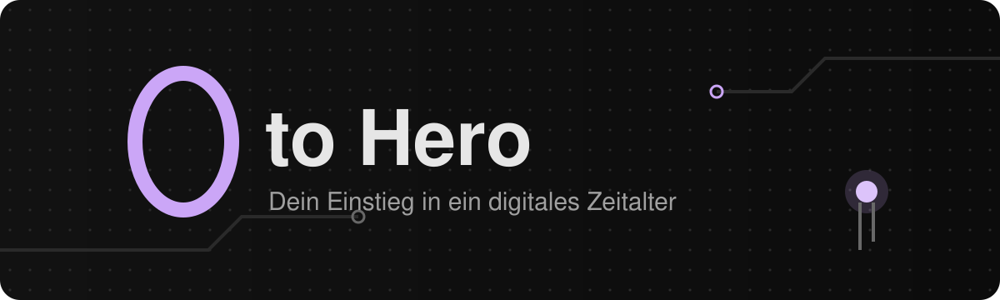

<p align="center">
  
</p>

<p align="center">
  <a href="https://r-winter-mute-dev.github.io/ZEROTOHERO/"></a>
</p>

<p align="center">
  <a href="https://github.com/r-winter-mute-dev/ZEROTOHERO/actions/workflows/deploy.yml"></a>
  
  
  
  
</p>

<p align="center">
  <em>Diese Website wurde gebaut, um jedem Menschen die Möglichkeit zu geben, zu verstehen, was um ihn herum passiert:<br>von der blinkenden LED bis zum selbst lernenden Roboterarm.</em>
</p>

---

**0 to Hero** ist ein kostenloser, interaktiver Kurs für alle, die bei null anfangen. Du lernst nicht erst Theorie und baust dann irgendwann etwas. Du baust von Anfang an echte Geräte, und jedes Thema kommt genau dann, wenn du es brauchst.

Willkommen und viel Spaß beim Lernen.

## Kampagne 1: Die smarte Türklingel

> Am Ende hängt an deiner Tür eine selbst gebaute Klingel: Ein **ESP32-CAM** mit **18650-Akku** wacht auf Knopfdruck aus dem Tiefschlaf auf, macht ein Foto und schickt es an **Telegram** oder **Discord**. Ganz ohne Kabel.

Der Weg dorthin beginnt mit einer einzelnen LED.

## So funktioniert der Kurs

| | |
| --- | --- |
| **Neun Akte, neun Teile** | Jeder Akt baut ein Teil der Klingel. Auf der Startseite füllt sie sich Teil für Teil. |
| **Kleine Schritte** | Eine Erklärung, ein Merksatz, eine kurze Frage. Ein Spickzettel steht immer daneben. |
| **Echte Prüfungen** | Quiz, Rechenaufgabe, Simulator oder ein Messwert von deinem eigenen Aufbau. |
| **Bosskämpfe** | Am Ende jedes Akts wartet eine Fehlersuche: Etwas funktioniert nicht, und du findest heraus, warum. |
| **Auch ohne Hardware** | Wer die Bauteile noch nicht hat, kommt im Simulator weiter und holt die echten Prüfungen später nach. |
| **Anpassbar** | Schriftgröße, Zeilenabstand, Bewegung und ein Fokusmodus lassen sich einstellen. |
| **Kein Konto, kein Tracking** | Der Fortschritt bleibt in deinem Browser und lässt sich als Code sichern oder übertragen. |

## Lehrplan

| Akt | Teil | Du lernst | Stand |
| :---: | --- | --- | :---: |
| 0 | Grundplatte | Sicherheit, Steckbrett, Multimeter | ✅ |
| 1 | Knopf | Stromkreis, Spannung, Strom, Masse, Ohmsches Gesetz, Reihe und parallel, Spannungsteiler, Leistung, Taster. Ergebnis: Klingel v0, die summt | ✅ |
| 2 | Gehirn | Mikrocontroller (ESP32), erste Programme, Eingänge, Entprellen, Interrupts | ✅ |
| 3 | Stimme | WLAN, HTTP und APIs, Verschlüsselung, Zugangsdaten, Nachricht an Discord oder Telegram | ✅ |
| 4 | Auge | Kamera, Pixel und Bytes, Foto verschicken, Transistor und PWM. Ergebnis: Klingel v1, die ein Foto schickt | ✅ |
| 5 | Herz | Li-Ion-Akku und Sicherheit, erste Lötstellen, Laden, Spannungswandler, Kondensatoren. Ergebnis: Die Klingel läuft am Akku | ✅ |
| 6 | Schlaf | Energiebudget, Strom messen, Tiefschlaf, Akkustand | ✅ |
| 7 | Schalter | MOSFET, Selbsthalteschaltung, Ruhestrom fast null | ✅ |
| 8 | Gehäuse | Löten, Lochraster, Gehäuse, Montage | ✅ |

✅ spielbar

## Was du brauchst

| Ab Akt | Teile |
| :---: | --- |
| 0 und 1 | Steckbrett, Multimeter, Batteriehalter für 2 × AA, Widerstände, LEDs, Taster, aktiver Summer |
| 2 | ESP32-DevKit und ein USB-Datenkabel |
| 3 | nichts Neues, nur ein 2,4-GHz-WLAN und Discord oder Telegram |
| 4 | ESP32-CAM und Programmierplatine ESP32-CAM-MB |
| 5 | 18650-Akku, Lademodul mit Schutzschaltung, Buck-Boost-Wandler 3,3 V, Elko, Lötstation |

Die komplette Liste mit Links zu Roboter-Bausatz.de steht im Kurs auf der Seite **Einkaufsliste**, sortiert nach Akten.

## Mitmachen

Fehler gefunden, eine Erklärung unverständlich oder Lust, eine Mission zu schreiben? Beiträge sind willkommen. Wie eine Mission aufgebaut ist und welche Bausteine es gibt, steht in [CONTRIBUTING.md](CONTRIBUTING.md).

Am meisten hilft gerade:

- [ ] **Testen mit echter Hardware.** Einige Messbereiche sind vorläufig und brauchen Werte von echten Aufbauten.
- [ ] **Feedback zu Akt 2 bis 8.** Die Sketches sind syntaktisch geprüft, aber noch nicht auf jedem Board getestet.
- [ ] **Feedback von Einsteigern.** Wo bist du hängen geblieben?
- [ ] **Ideen für die nächste Kampagne.** Was soll nach der Klingel kommen?

## Entstehung

> [!NOTE]
> Dieser Kurs entsteht mit Unterstützung von **Claude**, einer KI von Anthropic. Die KI ist für dieses Projekt verändert und auf wissenschaftliches Arbeiten ausgelegt.

- **Belege zuerst:** Fakten stützen sich bevorzugt auf systematische Reviews und Meta-Analysen, begutachtete Studien, Datenblätter der Hersteller und Normen. Foren, Blogs und soziale Medien gelten nicht als Beleg.
- **Kennzeichnung:** Werte, die nicht aus einem Datenblatt oder einer Messung stammen, sind im Kurs als vorläufig oder als Richtwert markiert.
- **Lernpsychologie:** Der Aufbau der Missionen (kurze Schritte, Merksätze, Fragen direkt nach jeder Erklärung, Spickzettel, wenig Ablenkung) folgt der Forschung zu Arbeitsgedächtnis, Segmentierung und ADHS. Wo es keine direkte Studie zu einem Elektronikkurs gibt, ist das eine begründete Übertragung, kein Nachweis.

Die Idee, die Ziele und die Entscheidungen kommen von einem Menschen. Texte, Übungen und Firmware schreibt die KI, ein Mensch prüft sie und gibt sie frei. Auch so können Fehler drinstecken. Wenn dir etwas falsch vorkommt, [öffne ein Issue](https://github.com/r-winter-mute-dev/ZEROTOHERO/issues). Hinweise mit Quelle helfen am meisten.

## DISCLAIMER

Die in diesem Projekt genannten Produkte und Hardware-Komponenten sowie die dazugehörigen Kauflinks dienen ausschließlich als Empfehlungen und Orientierungshilfe.

**Es bestehen keinerlei Affiliate-Partnerschaften, Werbeverträge oder sonstige bezahlte Kooperationen.** Durch die Nutzung der verlinkten Angebote erhalte ich weder Provisionen noch sonstige finanzielle oder materielle Vorteile.

Mir war es lediglich wichtig, einen zuverlässigen Anbieter zu empfehlen, bei dem ich selbst einkaufe und mit dem ich bisher gute Erfahrungen gemacht habe. Dabei stehen für mich faire Preise, Zuverlässigkeit und ein möglichst unkomplizierter Beschaffungsprozess im Vordergrund.

Die Verlinkungen sollen euch außerdem die teilweise zeitaufwendige Suche nach geeigneten und kompatiblen Hardware-Komponenten ersparen.

**Selbstverständlich steht es jedem frei, die aufgeführten Produkte bei einem anderen Händler zu erwerben.** Gleichwertige Produkte anderer Hersteller oder Anbieter können jederzeit verwendet werden, sofern sie die entsprechenden technischen Anforderungen erfüllen und kompatibel sind.

Die genannten Produkte stellen somit keine zwingende Kaufvorgabe dar, sondern lediglich eine praktische Empfehlung.

**Kurz gesagt:** Keine Werbung, keine Provisionen, keine Verpflichtungen – lediglich persönliche Empfehlungen, die euch Zeit bei der Auswahl und Beschaffung geeigneter Hardware ersparen sollen.

## Für Entwickler

<details>
<summary><strong>Lokal starten</strong></summary>

Voraussetzung: Node.js 22.23.4 oder neuer (empfohlen: Node 24).

```bash
npm install
npm run dev
```

Die Seite läuft dann unter http://localhost:4321.
</details>

<details>
<summary><strong>Technik</strong></summary>

Statische Seite mit [Astro](https://astro.build) und MDX, ohne Server und ohne externe Dienste. Jede Mission ist eine MDX-Datei in `src/missionen/`, die Prüfungen sind wiederverwendbare Komponenten in `src/components/`. Die Firmware für jede Mission liegt in `firmware/`. Die Seite wird über GitHub Actions automatisch auf GitHub Pages veröffentlicht.
</details>

<details>
<summary><strong>Eigene Kopie betreiben</strong></summary>

Repository forken, unter **Settings → Pages** als Quelle **GitHub Actions** wählen, fertig. Der Workflow setzt den Pfad der Seite selbst.
</details>

## Lizenz

| Was | Lizenz |
| --- | --- |
| Inhalte (Missionen, Texte, Zeichnungen) | [CC BY-SA 4.0](LICENSE-INHALTE.md): teilen und bearbeiten erlaubt, mit Quellenangabe und unter derselben Lizenz |
| Code | [MIT](LICENSE) |
| Schrift | Atkinson Hyperlegible, SIL Open Font License |
